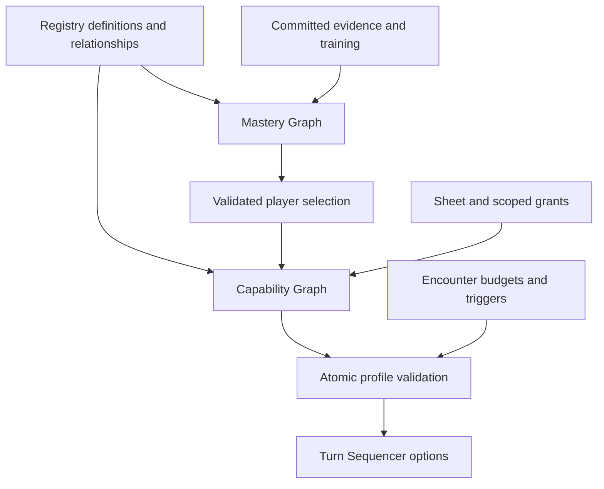

# Genesis Protocol — Character Capability & Mastery Architecture

**Version:** 0.1 · **Status:** Proposed design contract for owner review  
**Suggested repository path:** `Contracts/CHARACTER_CAPABILITY_AND_MASTERY_CONTRACT_v0.1.md`

This design extends the fluid progression tree with two Registry-backed views. The Capability Graph answers “what can this character access, from which source, under what conditions?” The Mastery Graph answers “what has this character improved, what evidence supports it, and what can they choose next?” A character's learned Dodge technique, current proficiency, equipped item activation and remaining reaction can all differ independently.

The contract is prospective. The existing campaign-scoped Minor Telekinesis ruling remains authoritative where it applies. Secondary Action eligibility and capacity follow SA-001 only in a future rules version that adopts it. This deliverable authorizes no schema migration, runtime change, campaign write, accepted dice change, or gateway work.

## 1. Identity and Registry authority

- Reuse promoted **Action**, **Feature** and **Power** definitions as executable capability anchors. Reuse existing skill identities when canonical. If a skill has no suitable identity, propose a minimal promoted skill definition that describes the competency and links to affected capabilities. An ordinary proficiency such as skill/tool training can affect checks without being an executable action.
- Keep the existing local `id` and deterministic Registry `urid` convention from Design Decisions. Resolve existing IDs through authoritative Registry mappings. Use owner-qualified node and profile keys (owner URID + local node/profile ID), pinned to a separate definition or rules version. Names, aliases, tags, translations and similarity are discovery metadata. An alias collision asks for clarification; it cannot establish entitlement.
- Capability and mastery are projections of approved definitions and committed character records. Reuse the Registry's approved global definitions, campaign-local definitions, character instances and typed relationships. Candidate builds, search/vector matches, YAML presentation examples and undisambiguated legacy strings cannot grant mechanics. Registry indexes may be rebuilt from approved sources.
- Keep one canonical identity for a capability across sources and ranks. Create distinct capability identities where effects or permissions have independent meaning, such as Minor Telekinesis vs. Force Pull. Stable aliases map to one approved identity within a ruleset; identity or version changes need explicit compatibility mappings.

## 2. Graphs, edges and state

| Graph | Nodes / records | Edges and authority |
|---|---|---|
| Capability | Class, species, background, training, character instance, progression node, item instance, learned power, campaign ruling, capability and execution profile | `grants_access`, `grants_profile`, `grants_capacity`, explicit `grants_uses` and `requires` are proposed typed relations. Each mechanical edge is owned by a validated source. |
| Mastery | Canonical skill or capability anchor, mastery node, evidence policy, recorded training, committed evidence and selected rank/branch | `requires` checks held nodes or other typed conditions. `improves` points to an existing capability/profile and gives a bounded modifier or an explicit profile entitlement. |
| Cross-tree relationships | Existing progression nodes, branch clusters and approved Registry relationships | A synergy edge proposes or describes a combination. Only an explicit, promoted mechanical rule can change validation or execution. |

These edge names describe semantics for mapping into the existing relationship vocabulary, not approved Registry tags. Require resolvable endpoints, valid scopes and version references. Reject cycles in hard prerequisites across both graphs. A prerequisite can require a prior qualifying entitlement or node, but cannot be satisfied by the proposed award itself. Soft synergy links may be reciprocal. A subclass is a named cluster, with existing title qualifications, rather than a class lock on every member node. Class ownership identifies roots. Existing cross-tree level, prerequisite and affinity gates still apply. Count choice groups over qualified IDs across the graph and validate exclusivity together with the choice commit.

Project actor state in separate fields for active grant instances, held progression nodes, ordinary proficiencies, mastery ranks/branches, per-anchor evidence totals, and encounter state. An instance grant carries source ID and instance where applicable, actor, scope, capability and profile references, validity predicates, evidence, authority and rule version. Keep inactive grant provenance for audit. Losing a temporary or equipment source suspends its access/profiles at the accepted state change. Previously recorded mastery remains, but requires valid access to be executable.

## 3. Acquisition and advancement

| Path | Authoritative input | Result |
|---|---|---|
| Creation | Validated species, class, background, selections, training, known powers, starting gear and any named ruling | Seed guaranteed source grants and confirmed choices together. Validate pick counts, learned powers and prerequisites. Inventory confers only the specific active item grants. Baseline ranks require explicit authoring, never guess from a title. |
| Level-up | Committed level or character XP qualification and eligible progression nodes | Open or award only what the adopted rules specify. Automatically granted core features need explicit source rules. Elective nodes require player confirmation and any applicable spend. Preserve the legacy level progression reader where active. |
| Use-based mastery | Accepted evidence attached to a canonical skill/capability and rule version | Accumulate toward eligible improvement nodes. Threshold completion opens a choice. It does not grant the node, a level, or a learned power. |
| Specialized training | Committed training objective and completion, with approved instructor/resource, time, conditions and outcome as authored | Satisfies named prerequisites and may contribute evidence under that policy. A permanent learned capability requires its own explicit validated acquisition edge. |

Keep character XP, node purchase costs, mastery evidence credit and tag affinity distinct. A source event may inform several tracks only through separate authored rules. No implicit exchange or affinity-to-proficiency conversion. Legacy `Feature.xp_cost` and `Power.upgrades[].xp_cost` retain their purchase meaning.

A mastery node declares its anchor, level/ruleset/scope where relevant, required held nodes, evidence threshold and category minima, tags and affinity requirements, training requirements, choice group, optional explicit cost pool, and typed outputs. Prefer declarative `all`/`any` conditions with stable references. Use cumulative qualified credit to evaluate a rank threshold. If an authored node also has a price, spend only the named pool and record the debit atomically with the player's decision. Thresholds are versioned per anchor/path and may require distinct contexts or training categories. Values and rank pacing require balance approval. The player can defer an eligible choice. Branches combine unless the authored group or merge rules explicitly prohibit it. Respec, if approved, needs a recorded transaction with dependent-node validation and explicit cost/refund policy.

## 4. Evidence, accumulation and anti-exploit policy

1. The Record Keeper reads final committed outcome events and links each candidate to the actor, source action/step or encounter trigger, anchor, execution profile, objective/session, accepted event IDs, and evidence policy version. The evidence record also includes meaningful challenge category, declared stake or training rubric, eligibility reason, and awarded amount. Accepted no-roll outcomes can qualify under the same rubric. Failed attempts may qualify where they meet the declared learning conditions. Dice count and repeated clicks do not measure learning.
2. Assign each qualifying step or bounded training objective a stable observation identity. Derive an idempotency key from campaign, actor, canonical anchor, observation identity and credit category. Policy version is recorded for replay and does not mint a new key for an old observation. Link multiple consequence events to the same observation instead of counting each as a use. One observation can credit multiple anchors only through an explicit contribution rule and shared award budget. Corrections use linked adjustment events, never retroactive replacement of accepted gameplay or dice.
3. Eligible evidence requires actual use of the relevant competency, a committed outcome and meaningful stakes, novelty, or a structured training objective with defined assessment criteria. Deny preflight, canceled or pending steps, uncommitted narrative, incidental repetitions, and replay. Practice on a stationary target can count through a validated drill with a new objective or assessment. Repetition of the same easy drill after its goal is met yields no additional credit.
4. Apply deterministic diversity and repetition rules keyed to objective, relevant conditions and challenge family. An authored policy may impose per-objective and per-window caps, diminishing returns and minimum distinct conditions. Difficulty or learning conditions must come from pre-existing encounter or training facts. Renaming an action, swapping identical items, changing providers, reloading or starting a new UI session cannot refresh a cap. Track resets on ruleset-owned boundaries, never browser time.
5. Accumulate from accepted credit events with the pinned policy. Replay/recovery consumes the same receipts once. The advancement validator checks the fresh revision, current prerequisites, group membership and any funds at confirmation. Persist choice, debit and grant effects as one accepted transaction. Preserve derived totals separately from raw evidence and show the player qualified credit and unmet requirements without exposing hidden DCs or GM facts.

Conditional gear can provide evidence of transferable skill only where a policy explicitly identifies player contribution to that skill. A self-aiming tool's success alone grants no Throwing mastery. An equipment profile can award item-specific training evidence where authored, but never becomes a permanent capability without a separate approved grant.

## 5. Execution profiles and the Turn Sequencer

Each approved execution profile defines an effect envelope, mode, timing/trigger, target and geometry predicates, requirements (hands, equipment, status, proficiency), resolution reference, duration, costs with units, shared and local usage limits, reset owner, and stacking group. Proficiency can change a named modifier, check method or consequence through an explicit rule. It changes neither access nor cost by default. Explicit bounded profile grants may alter cost, reliability, scope or available targets. Apply modifiers in a specified order, deduplicate identical profile grants, and reject unresolved conflicts rather than choosing a permissive one.

| Ledger quantity | Example distinction |
|---|---|
| Eligibility | A learned technique or eligible equipped item supplies access. |
| Proficiency and mastery | A selected node modifies an authored part of execution. |
| Profile cost | An authorized alternative costs one Bonus Action rather than its normal action slot. |
| Remaining budget and uses | A remaining Bonus Action can be spent only if the shared capability limit and item charges also permit it. |

Equipment records declare whether a grant needs possession, equipped state, attunement, proficiency or live charges, and which capability/profile and cap group it grants. Two items giving the same profile do not multiply its effect or shared usage ceiling. Explicit capacity, extra use and activation grants are independently consumed. Prospectively, SA-001's Secondary Action is a separate resource (ordinary allowance one where enabled). A profile eligible for Secondary does not add capacity or convert a Bonus/Primary slot. Legacy `secondary_activity` stays subject to its existing meaning.

Atomic derives options from the accepted actor, campaign/rules version, Registry definitions, active grants, held nodes, equipment instances, scene, mode, and encounter-owned budgets and counters. For every eligible profile it resolves legality and safe reason codes. Feed the Sequencer the legal variants and visible reasons for blocked variants. A player picks the effect and profile, or clarifies if free text maps ambiguously. Bind action ID, ordered steps, target and exact wording to the accepted declaration. Walk steps in order against projected state, including equipment changes, positions and spends. Revalidate authoritative state before acceptance. Literal zero remains zero. Stop before uncertain conditions, reactions or material choices under the existing interruption contract. Resume only with required authorization and current predicates. The GM and UI cannot infer new abilities, cheaper slots or extra actions. Commit with accepted costs/profile IDs and dice references through the existing authority, then project the result.

Reactions require an authored trigger, legal timing, independent capacity and a trigger-specific use key. A mastery counter can be part of the same paid reaction only if the profile explicitly includes its cost and effect. A separately declared reaction requires an available authorized pool. An exception (additional reaction, reduced cost, triggered follow-up) must identify allowed triggers, use ceiling, expiration and mutual exclusions. A spent ordinary reaction remains spent. Trigger chains must terminate, cannot retrigger from their own outcome unless separately approved and bounded, and preserve the player's declared choice of whether and how to respond. Passives cannot be repeatedly activated by issuing commands.

## 6. Design cases

| Capability | Proposed branches and boundaries |
|---|---|
| Dodge | **Novice:** choose a target/threat under the profile's targeting rule. **Proficient:** broad coverage over eligible threats. **Advanced:** an optional counter after a qualifying successful defense, subject to timing, reach, permission and cost. **Master:** exceptional reflexes and explicitly bounded defensive triggers. A witnessed defense can supply evidence for an authored Fear response, subject to observer perception and applicable resistance, cooldown and NPC evaluation rules. No universal fear status or free extra attack follows rank alone. |
| Minor Telekinesis | Retain Aero's recorded campaign exception and formal training evidence. Current envelope is one visible unattended object of at most 10 lb, within 30 ft throughout, gentle handling, zero Force Points, one action in combat, and roll-free straightforward use outside combat. Precision can improve delicate placement and handling, range can improve reliability within the envelope or propose a separately approved cap change, and control can improve stability for eligible objects. No offensive use, creatures, disarming or projectile interception. No addition to `powers_known`, Force Push, Force Pull or Force Lightning. Roll defaults, hands and sustained handling remain subject to the existing provisional ruling. |
| Throwing | Reuse an approved Throwing competency if available. Each profile binds object type, target, objective and ruleset resolution. Proposed branches cover accuracy, finesse, safe handling and specialized techniques. A committed delivery under changing conditions or an assessed training drill can qualify. Repeating a trivial throw against the same objective does not. Training does not grant unrelated weapon use, item recovery, or the ability to throw without an available object or legal target. |

The proposed Dodge probabilities **50%, 66.7%, 83.3%, 98%** are hypotheses for comparable **per-trigger** cases, not rules. Define the reference threat, timing, modifiers and roll model before testing. A single fair d20 has 5-point resolution, so several figures cannot be exact single-d20 probabilities. Benchmark expected damage prevented and counterattack value across multiple threats, resources, coverage and trigger frequency. Broader coverage and extra triggers can increase defense even with identical per-trigger success. Decide whether to adopt fixed rates, existing checks or another approved model after testing; no figure is applied here.

## 7. Schema gaps and reuse

| Source | Reuse | Proposed gap closure |
|---|---|---|
| `Class.schema.json` | Flat `progression_tree`, legacy `level_progression`, feature/node IDs, tags, level, prerequisites, branch, group, synergy | Add typed cross-domain references, evidence requirements and outputs through an additive Registry graph projection or optional extension. Keep old readers. Define conflict handling if both tree fields exist. |
| `Feature.schema.json` | Feature ID, mechanics, activation cost list, trigger, targeting and XP cost | Single activation object lacks source-aware alternatives and shared limits. Map existing profiles where unambiguous. Specify structured timing and units without changing legacy enum semantics. |
| `Power.schema.json` | Access rules, casting time, power costs, rest use, base effect, XP upgrades with prerequisites | Link learned entitlement and upgrade IDs to profiles. Author when upgrades require mastery evidence. Keep purchase XP and Force/Tech pools distinct. |
| `Action.schema.json`, `Item.schema.json` | Action cost types, skill check and effects. Item properties, modifications and effects | Normalize cost alternatives for the opted-in ruleset. Add typed per-instance equipment grants and qualification predicates. Confirm which data currently drives equip/attune state. |
| `Character.schema.json` and campaign overlays | Skills, proficiencies, equipment, features, level and XP. Existing sheet and scoped exceptions | Add versioned derived state for provenance, held selections, affinity, mastery evidence and inactive access. Do not assume the Class affinity field already has a character-side projection. |
| Registry and turn contracts | Approved lanes, aliases, relationship edges, published context and ordered steps | Validate promotion and references, maintain idempotent evidence and advancement transactions, and add versioned profile/cost/usage projection. Current `UNLISTED_POWER` handling leaves authority with GM/runbook checks; future Atomic resolver needs explicit authoritative capability preflight. |

Add a reusable schema only if the cross-domain records cannot be validated inside existing definition and relationship envelopes. Prototype normalization in read-only mode first. Missing IDs require a mapping review, never a broad string match. Legacy projections must reproduce existing legal moves and spending until a campaign adopts the new rule version. Historical dice and ledgers retain their original definitions and receipts.

## 8. Dependency map

The Record Keeper derives affinity and mastery from committed outcomes. Atomic validates both progression and execution. Chaos can discover cross-tree relationships for review. Soul and the Datapad explain legal options and progress using records supplied by those authorities. Accepted executions can supply evidence for later progression, never for eligibility within the action that produced them.

## 9. Acceptance criteria

- Two sources resolve to one capability. An alias collision or candidate-only source grants nothing. A valid cross-tree choice succeeds and an unmet hard prerequisite, cycle or exclusive selection fails.
- Creation commits only declared choices and authored grants. Threshold crossing or a level-up does not auto-pick an elective node. Concurrent confirmations cannot overdraw a pool or acquire both nodes in an exclusive group.
- Legal meaningful success, qualifying failure and assessed training each follow their rubric. Replay, multiple events for one attempt, repeated trivial practice and equivalent item swaps do not multiply credit. A rest/reload only resets counters as the ruleset authorizes.
- Item removal mid-sequence disables the affected later profile while learned mastery remains on record. Two alternate profiles share the authored use cap. Distinct, authorized capacity and use exceptions work only within their scope.
- Zero action or reaction budgets stay zero. A defensive trigger can be declined and cannot recursively produce free counters. A Fear effect requires its approved witness and resolution conditions. Exact declared steps and wording survive interruption and continuation.
- Aero's existing Minor Telekinesis scope and restrictions pass compatibility checks. Unlearned powers and invalid targets fail authorization. Dodge rates and Throwing thresholds must be explicit candidate data in isolated fixtures, with no effect elsewhere.
- Legacy campaign replays retain equivalent options, event order, budgets and dice receipts. Replaying accepted advancement produces identical state without duplicate credit, spend or grant. Public projections omit hidden thresholds and private encounter facts.

## 10. Proposed implementation sequence

1. **Inventory and decisions.** Map canonical anchors, aliases, Class nodes, candidate-only references and current adapters. Ratify evidence categories, eligibility semantics, grant precedence, and the ruleset/version boundaries.
2. **Read-only Registry projections.** Normalize existing definitions, test referential integrity and cross-graph prerequisites, and compare projected access against current sheets and campaign overlays without changes to gameplay.
3. **Isolated evidence and advancement fixtures.** Use synthetic outcomes to validate credit deduplication, training, choice atomicity, load/replay and correction. Keep the existing progression path active by default.
4. **Atomic profiles in a noncanonical fixture.** Validate ordered steps, cost/usage accounting, equipment suspension, reactions and Secondary gating. Test one narrowly authored vertical slice per design case before adding UI choices.
5. **Playtest and tune.** Compare Dodge coverage/counter balance, Telekinesis boundaries and Throwing practice cadence. Review public reason codes, accessibility, reset ownership and source explainability. Adoption or migration requires a separate explicit decision.

Still open for owner review: mastery credit curves and diverse-practice requirements, level/XP interplay, training access and downtime costs, branch exclusivity/respec, proficiency stacking and equipment edge precedence, transfer from gear-assisted practice, Dodge resolution and Fear safeguards, any increase to Telekinesis limits, and campaign opt-in/migration. The ongoing cross-provider acceptance milestone is independent of these decisions.

## Repository evidence

Reviewed the following files at integration commit `80f120a1d72c3822d35facccfa4c8b7e02b211ec`: `schema/{Class,Feature,Power,Character,Item,Action}.schema.json`, `Contracts/02_Progression_Tree_System.md`, `Contracts/skill_tree_system.yml`, `campaigns/starwars_litrpg/creator/{DESIGN_DECISIONS,JEDI_FUNDAMENTALS}.md`, `registry/build_corpus_registry.py` and `campaigns/starwars_litrpg/ui/turn_contract.js`.

Read `Contracts/SECONDARY_ACTION_AND_CAPABILITY_ACTIVATION_CONTRACT_v0.1.md` from `docs/tb4-whisper-contract-v0.1-20261117` at `6cfefd5190121aae00848f684e084996f7ccadf2`. The visual tree documents inform presentation, including cross-class links and lock states. Canonical authority comes from recorded rules and approved Registry definitions.