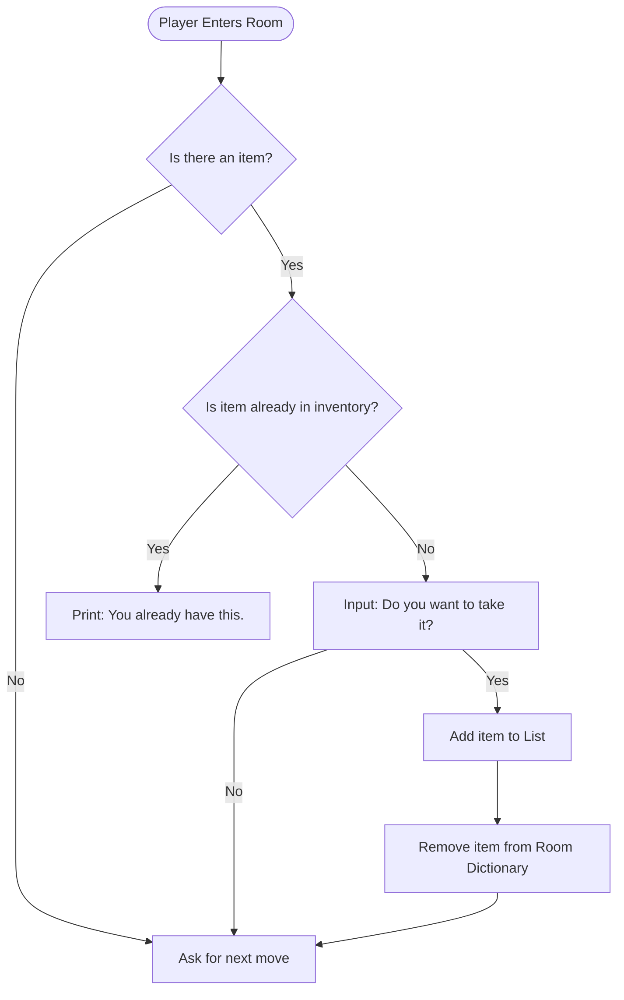

```d2
Start: {shape: oval}
Loop Condition: {
  label: Is 'Exit' typed?
  shape: diamond
}
End: {shape: oval}
Game Logic: {shape: rectangle}

# 2. Define the Connections (The Logic)
Start -> Loop Condition

# If 'Yes', we break the loop
Loop Condition -> End: Yes

# If 'No', we run the game code
Loop Condition -> Game Logic: No
Game Logic -> Loop Condition: Update State & Repeat
```

